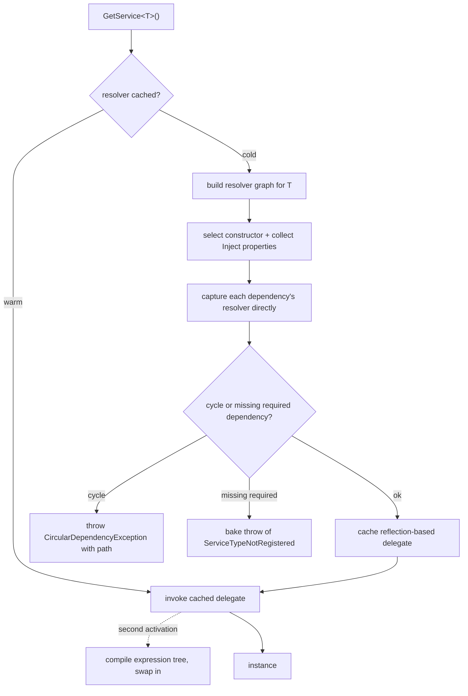
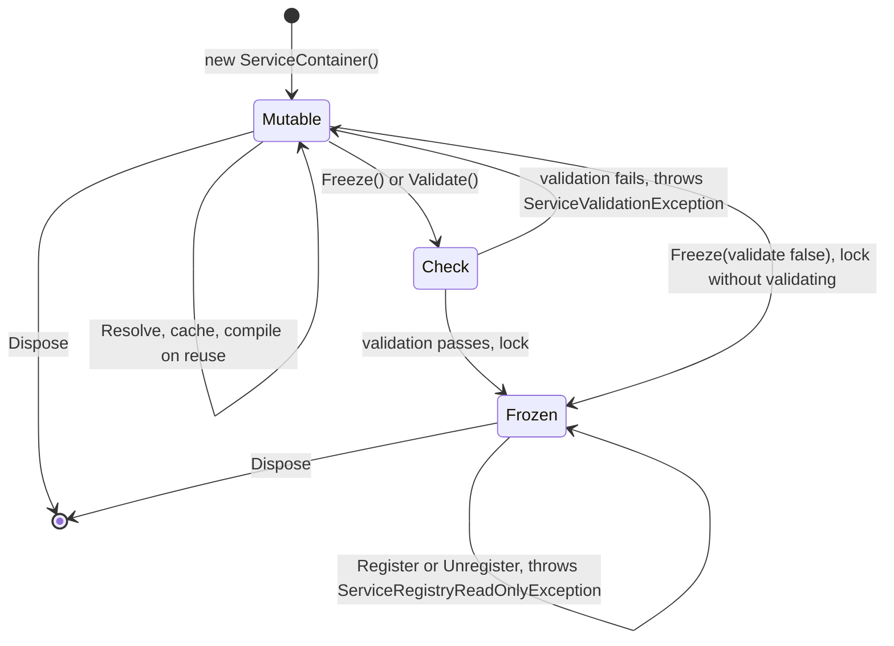

# Architecture

How `Snowberry.DependencyInjection` resolves services, and how the container moves from its default mutable
state into the opt-in frozen state.

## Resolution: the tiered resolver graph

Every resolve goes through a **per-service resolver**, a `Func<scope, object?>` cached per service.
The first resolve of a type is *cold*: the container builds the resolver graph for that type, capturing each
dependency's resolver delegate directly so there is no per-argument re-dispatch. Every resolve afterward is
*warm*: a dictionary lookup plus a delegate call. Singletons are baked to constants and scoped instances are
read lock-free, so warm singleton/scoped resolves allocate nothing.

The graph is built eagerly over the resolved subtree, so structural problems surface as real exceptions rather
than late or fatal failures.

Activation is **tiered**. A newly built node constructs its instance through reflection
(`ConstructorInvoker`), which costs nothing to build. On its second activation the node compiles an expression
tree (inlining simple transient children) and swaps it in; every holder of the resolver sees the compiled
delegate from then on. Services activated only once, which includes every singleton, are never compiled, which
keeps startup cheap. Under Native AOT, or on runtimes that interpret rather than compile expression trees, the
reflection tier is the steady state and the expression compiler is trimmed away.

A registration change atomically invalidates the affected cached resolvers; they rebuild lazily on the next
resolve. This is what keeps dynamic add/remove correct while the container stays mutable.

## Container lifecycle: mutable → frozen

The container starts **mutable** and can be registered into, overwritten, and unregistered from at any time.
`Freeze()` is a one-way, idempotent transition into the **frozen** state. By default it validates the graph
first; if validation fails it throws and the container stays mutable.

### Mutable vs frozen

| | Mutable (default) | Frozen (`Freeze()`) |
| --- | --- | --- |
| Add / remove / overwrite | Yes | No, throws `ServiceRegistryReadOnlyException` |
| Resolver caching | Per-generation, invalidated on registration change | Permanent (no invalidation machinery) |
| Optimizations | Cached tiered resolvers, baked singletons, lock-free scoped reads | Above **plus** inlining of whole transient subtrees into their parent |
| Use when | You may reconfigure at runtime | Configuration is final and you want top speed |

Freezing only changes *how* resolution is compiled. Resolved instances, lifetimes, and disposal behavior are
identical to mutable mode.

## Lifetimes & disposal ownership

- **Singleton:** one instance per container, constructed against the root scope and disposed with the
  container.
- **Scoped:** one instance per scope, disposed when that scope is disposed. Resolving a scoped service
  directly from the container uses the container's own root scope.
- **Transient:** a new instance on every resolve, disposed by the scope that created it.

Instances **you** supply (`RegisterSingleton<T>(instance: ...)`) are never disposed by the container; instances
the container constructs are. Disposal is LIFO within each scope.

Disposal always visits every tracked instance, even when some of them throw. A single failure is rethrown
unchanged; several failures are thrown together as an `AggregateException`, in disposal order. This applies to
`Dispose` and `DisposeAsync` of both scopes and the container, and matches
`Microsoft.Extensions.DependencyInjection` from .NET 11 on. Synchronous `Dispose` reports an instance that only
implements `IAsyncDisposable` as an `InvalidOperationException` and still disposes the rest. Once a scope is
disposed it accepts no new disposables: an instance created by a resolve that races the disposal is disposed
immediately and the resolve throws `ObjectDisposedException`.
